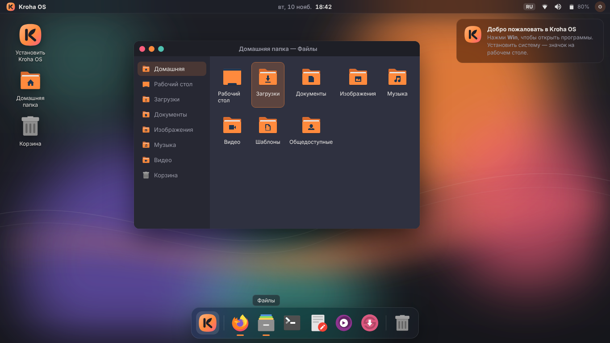
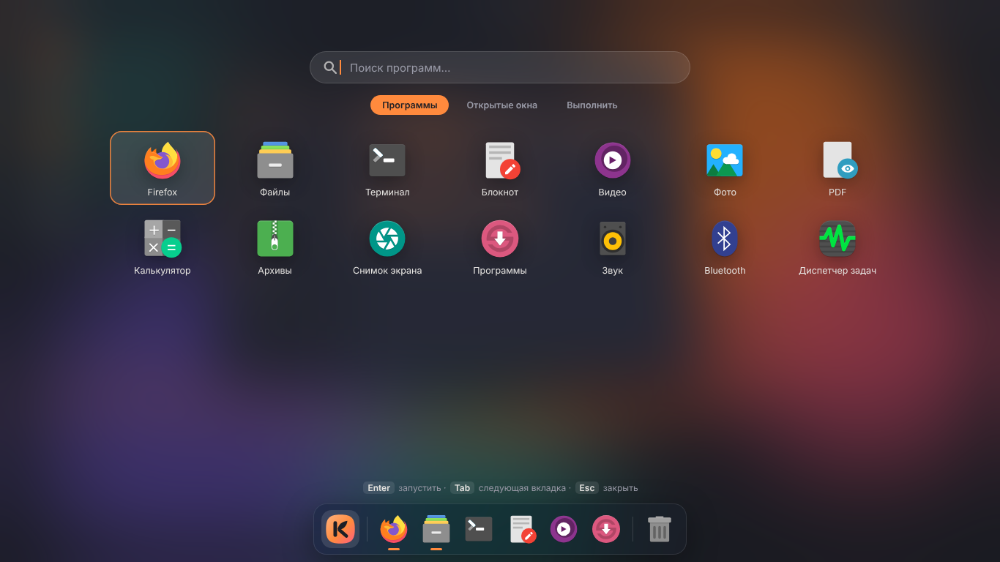

# Kroha OS 🧡

Лёгкая система на основе **Debian 13** для ноутбука **HP Laptop 15-bw0xx**
(AMD A10-9620P, Radeon R5 + R7 M340, 8 ГБ ОЗУ, экран 1366×768).

Сверху тонкая строка с часами, снизу парящий **док с размытием**, а по клавише **Win**
открываются все программы во весь экран.

| Рабочий стол | Лаунчер (клавиша Win) |
|---|---|
|  |  |

> Это макет (`design/mockup/`). Внутри ISO используются те же цвета, иконки и расположение.
> Скриншоты настоящей системы из виртуальной машины прикладываются к каждой сборке
> (артефакты `qemu-uefi` / `qemu-bios` на вкладке **Actions**).

**Что внутри:** Firefox с блокировщиком рекламы, файлы, видео (mpv), фото, PDF, архиватор,
калькулятор, снимки экрана, установка программ мышкой (Synaptic), Wi-Fi, Bluetooth, звук,
русский язык и раскладка (переключение **Alt+Shift**).

---

## Установка — по шагам

### 1. Скачай образ

1. Открой страницу **[Releases](https://github.com/nlponae269/Kroha/releases)**.
2. Скачай файл `kroha-os-…-amd64.iso` (около 860 МБ).
3. *(По желанию)* проверь, что файл скачался без ошибок: рядом лежит `SHA256SUMS`.
   - Linux: в папке с файлами выполни `sha256sum -c SHA256SUMS` — должно быть «OK».
   - Windows: `certutil -hashfile kroha-os-…-amd64.iso SHA256` и сравни с числом из `SHA256SUMS`.

### 2. Сделай резервную копию ⚠️

Скопируй всё важное (документы, фото, пароли, закладки) на флешку, внешний диск или в облако.
Установщик не стирает диск сам, но при ошибке выбора пункта данные можно потерять —
поэтому копия обязательна.

### 3. Запиши образ на флешку (от 4 ГБ, всё на ней удалится)

**Из Windows — Rufus:**
1. Скачай [Rufus](https://rufus.ie) и запусти.
2. «Устройство» — твоя флешка. «Метод загрузки» — кнопка **ВЫБРАТЬ** → файл `.iso`.
3. «Схема разделов» — **GPT**, «Целевая система» — **UEFI**.
4. Нажми **СТАРТ**. Если спросит режим — выбери **«Записать в режиме DD-образа»**.

**Из Linux Mint:** правый клик по `.iso` → «Создать загрузочный USB-накопитель» → выбрать флешку → «Записать».

**Или Ventoy:** поставь [Ventoy](https://www.ventoy.net) на флешку и просто скопируй туда `.iso`.

### 4. Загрузись с флешки

1. Выключи ноутбук, вставь флешку.
2. Включи и сразу часто нажимай **F9** — появится меню загрузки.
3. Выбери флешку (обычно «USB Hard Drive» или название флешки).
4. Появится меню Kroha OS — нажми **Enter** (или подожди 5 секунд).

**Не загружается с флешки?**
- Включи ноутбук, жми **F10** → откроется BIOS.
- Вкладка **System Configuration → Boot Options**: выключи **Secure Boot** (*Disabled*),
  сохрани (**F10** → *Yes*).
  Обычно это не нужно: загрузчик и ядро — подписанные пакеты Debian (shim + GRUB),
  поэтому система должна грузиться и с включённым Secure Boot (на реальном HP пока не проверено).
- Если включил «Legacy Support» — система тоже загрузится, но лучше оставить UEFI.

### 5. Попробуй и установи

1. Загрузится рабочий стол Kroha OS — можно всё попробовать без установки (ничего на диске не меняется).
2. Подключи зарядку и интернет (значок сети справа вверху) — так установка пройдёт спокойнее.
3. Дважды щёлкни значок **«Установить Kroha OS»** на рабочем столе.
4. Выбери язык, часовой пояс и раскладку — нажимай **«Далее»**.
5. На шаге **«Разметка диска»**:
   - **«Установить рядом»** — Kroha OS встанет рядом с текущей системой (Windows или Linux Mint).
     Ползунком реши, сколько места отдать каждой. При включении будет меню выбора системы.
   - **«Стереть диск»** — ⚠️ удалит **всё** с диска, включая текущую систему и файлы.
     Выбирай, только если копия сделана и старая система больше не нужна.
   - «Ручная разметка» — для тех, кто знает, что делает.
6. Придумай имя пользователя и пароль (пароль нужен для входа и установки программ).
7. Проверь сводку и нажми **«Установить»**. Займёт 5–15 минут.
8. Когда появится «Готово» — поставь галочку «Перезагрузить», вытащи флешку.

После установки при включении появится меню: **Kroha OS** (загрузится через 2 секунды) или
твоя прежняя система.

> **Если ноутбук после установки сразу загружает Windows:** при включении жми **F9** и выбери
> **«Kroha OS»**. Чтобы так было всегда — в BIOS (**F10**) → *Boot Options* → *UEFI Boot Order*
> подними «Kroha OS» наверх.

---

## Как пользоваться

| Действие | Клавиши |
|---|---|
| Все программы и поиск | **Win** (одно нажатие) или клик по логотипу слева вверху |
| Классическое меню по категориям | правый клик по логотипу |
| Переключить язык | **Alt+Shift** |
| Файлы / Терминал / Firefox | **Win+E** / **Win+T** / **Win+B** |
| Заблокировать экран | **Win+L** |
| Снимок экрана (весь / область / окно) | **Print** / **Shift+Print** / **Alt+Print** |
| Окно на левую / правую половину | **Win+←** / **Win+→** |
| Развернуть / вернуть окно | **Win+↑** / **Win+↓** |
| Переключить окна | **Alt+Tab** |
| Список окон | **Win+Tab** |
| Выключение, сон, перезагрузка | **Win+X** или кнопка ⏻ справа вверху |
| Диспетчер задач | **Ctrl+Alt+Delete** |
| Громкость, яркость | клавиши на клавиатуре ноутбука |

**Установка программ:** в лаунчере открой **«Программы»** (Synaptic), найди нужное, отметь и нажми «Применить».
Офис (LibreOffice) не ставится сразу, потому что он тяжёлый — найди в Synaptic пакет `libreoffice-l10n-ru`.

**Эффекты (размытие дока, тени, скруглённые окна)** включаются сами, если видеокарта работает
с ускорением. Если что-то тормозит — в лаунчере найди **«Эффекты вкл/выкл»**.

**Игры на дискретной видеокарте R7 M340:** запускай так: `DRI_PRIME=1 имя_игры`
(в свойствах ярлыка допиши `DRI_PRIME=1 ` перед командой). В остальное время она спит и не тратит батарею.

---

## Если что-то не работает

**Чёрный экран при загрузке.** В меню загрузки флешки выбери
**«Запустить Kroha OS (безопасная графика)»**. В установленной системе: при включении в меню
нажми **e**, в строке, начинающейся с `linux`, допиши в конце ` nomodeset`, нажми **F10**.

**Нет Wi-Fi.**
1. Проверь, что Wi-Fi не выключен клавишей на клавиатуре (значок самолёта/антенны, обычно **F12**).
2. Нажми на значок сети справа вверху → выбери свою сеть.
3. Если сеть пропадает — в системе уже включено исправление для этой карты (Realtek RTL8723DE).
   Если всё равно рвётся — открой «Терминал» и выполни:
   ```bash
   sudo systemctl restart NetworkManager
   ```
   и напиши в [Issues](https://github.com/nlponae269/Kroha/issues).

**Нет звука.** Нажми на значок динамика справа вверху и проверь, что звук не выключен.
Открой в лаунчере **«Звук»** → вкладка «Выход» → выбери «Встроенное аудио» (а не HDMI).

**Не работает Bluetooth.** Открой в лаунчере **«Bluetooth»** — служба запускается сама при открытии
(так экономится память).

**Как посмотреть, сколько памяти занято.** Открой «Терминал» и набери `fastfetch`.

---

## Для разработчика

- Сборка ISO — только в **GitHub Actions** (`.github/workflows/build-iso.yml`):
  проверка → сборка в `debian:trixie` → тест в QEMU (UEFI и BIOS) → Release.
- Название и версия — `config/os-release.env`. Палитра — `design/palette.env`.
  Все темы генерируются из них (шаблоны `*.tmpl`, см. `scripts/lib.sh`).
- Локально (Debian trixie, root): `sudo scripts/build-iso.sh`, затем
  `scripts/test-qemu.sh out/kroha-os-*.iso uefi`.
- Макет экрана: `scripts/render-mockup.sh` → `out/mockup/*.png`.
- Подробности решений — в `CLAUDE.md`.

Основа — свободные пакеты Debian (Openbox, tint2, picom, rofi, Calamares, тема Arc и иконки Papirus),
оформление, логотип и обои — собственные.
